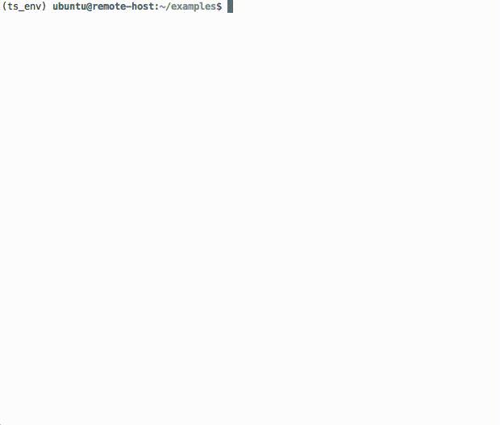

# niicat

This is a tool to quickly preview nifti images on the terminal. 
This can be helpful if you are working on a remote server via SSH and do not have
a -X connection. Niicat can also display png, jpg or similar images.

Your terminal must support inline images. Ubuntu's default terminal (GNOME Terminal / Ptyxis),
Apple Terminal, and Alacritty do not. When using SSH, it is the terminal on your local machine
that must support the protocol.

| Flag | Protocol | Works in |
|------|----------|----------|
| (default) | iTerm2 imgcat | [iTerm2](https://iterm2.com/), WezTerm, VS Code (enable `terminal.integrated.enableImages`) |
| `-kt` | [Kitty graphics](https://sw.kovidgoyal.net/kitty/graphics-protocol) | [Kitty](https://sw.kovidgoyal.net/kitty/), Ghostty, WezTerm |
| `-lb` / `-ls` | [Sixel](https://github.com/saitoha/libsixel) | mlterm, foot, WezTerm, Konsole, Windows Terminal, xterm (`-ti 340`) |


### Install:

```
pip install niicat
```


### Usage:

```
niicat T1.nii.gz
```



If nothing is displayed, your terminal likely does not support the selected protocol.
Try another flag from the table above, or switch to a terminal that does.

`-lb` uses `img2sixel` from `libsixel-bin` (`sudo apt install libsixel-bin`).
`-ls` uses `libsixel-python`.

Niicat was only tested on python >= 3.7.


### Copyright

Copyright © German Cancer Research Center (DKFZ), Division of Medical Image Computing (MIC).
Please make sure that your usage of this code is in compliance with the [code license](LICENSE).
